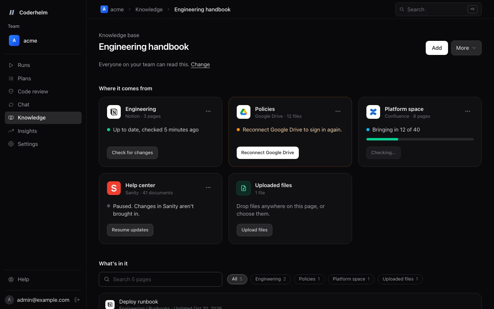
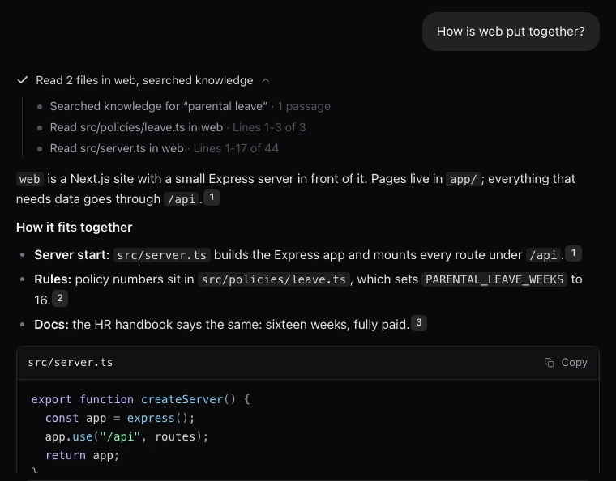
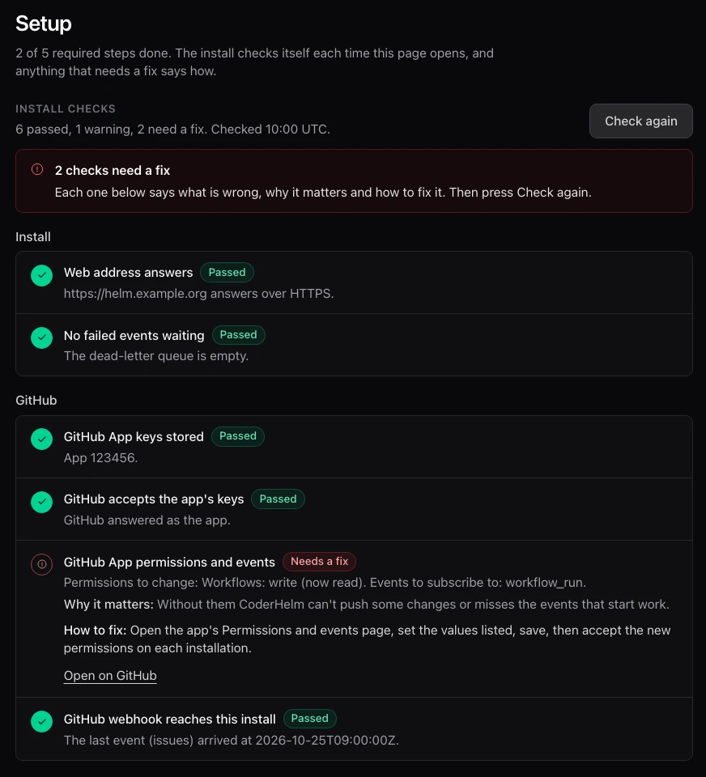

<p align="center">
  <picture>
    <source media="(prefers-color-scheme: dark)" srcset="brand/icon-white.svg">
    
  </picture>
</p>

<h1 align="center">CoderHelm: the AI coding agent for GitHub and Jira</h1>

<p align="center">
  <strong>Ship code, not tickets.</strong> Assign an issue, get a pull request. Then CoderHelm stays on the code.
</p>

<p align="center">
  <a href="https://coderhelm.com">Website</a> ·
  <a href="https://docs.coderhelm.com">Docs</a> ·
  <a href="https://docs.coderhelm.com/getting-started">Quickstart</a> ·
  <a href="https://docs.coderhelm.com/self-host/install/">Self-host</a> ·
  <a href="https://docs.coderhelm.com/changelog">Changelog</a> ·
  <a href="https://github.com/CoderHelm/coderhelm-platform">Platform repo</a>
</p>

<p align="center">
  <a href="https://github.com/CoderHelm/coderhelm/actions/workflows/ci.yml"></a>
  <a href="https://github.com/CoderHelm/coderhelm-platform/releases/latest"></a>
  <a href="LICENSE.md"></a>
  <a href="https://docs.coderhelm.com/llms.txt"></a>
</p>

CoderHelm is a source-available, self-hostable AI coding agent for teams on GitHub and Jira. Assign it a GitHub issue or a Jira ticket and it turns the ticket into a pull request: it plans the change, writes it on its own branch, runs your build and tests in a sandbox with no credentials, reviews its own work and opens the pull request. After that it keeps the code healthy: it fixes failing CI, answers review comments, reviews your team's pull requests, turns CloudWatch alarms into fixes, opens fix pull requests for dependency vulnerabilities your code actually reaches and closes stale pull requests. It runs on Claude, hosted at [app.coderhelm.com](https://app.coderhelm.com) or in your own AWS account.

This repository holds the dashboard, the docs site and the website. The agent, the AWS infrastructure and the self-host installer live in [CoderHelm/coderhelm-platform](https://github.com/CoderHelm/coderhelm-platform).

<p align="center">
  
</p>

## What it does

| Feature | What you get |
|---|---|
| [Tickets to pull requests](https://docs.coderhelm.com/getting-started/first-run) | Assign a [GitHub issue](https://docs.coderhelm.com/getting-started/github) or [Jira ticket](https://docs.coderhelm.com/getting-started/jira), add the `coderhelm` label or comment `/coderhelm`. A plan, the change, your tests, a self review and a pull request. |
| [PR reviewer](https://docs.coderhelm.com/getting-started/reviewer) | Add the review label (`ch-review` by default) to any pull request. A real GitHub review with line comments, a risk level and a verdict: it requests changes only for a named correctness, security or data loss problem with its evidence, and everything else is a labeled note. |
| [CI and review comment fixes](https://docs.coderhelm.com/getting-started/review-fixes) | Fixes failing CI on its pull requests, answers review comments, resolves conflicts and, with auto merge on, merges only the exact commit it reviewed. |
| [Alerts to fixes](https://coderhelm.com/alerts) | Route CloudWatch alarms and EventBridge events through SNS. Matching alerts become analyzed pull requests that a person approves. |
| [Stale pull requests](https://docs.coderhelm.com/getting-started/stale-pull-requests) | Off by default. Marks a pull request stale after 7 days with no activity from a person and closes it 7 days later, starting in Preview only and keeping the branch. |
| [Security fixes](https://docs.coderhelm.com/getting-started/security-fixes) | For each dependency advisory (OSV, GitHub advisories, Dependabot alerts), checks whether your code reaches the vulnerable part, gives it a tier and a deadline, and opens as few fix pull requests as it can (one per repository by default) with CI green, within daily limits you set. |
| [Failing and flaky tests](https://docs.coderhelm.com/concepts/test-fixes) | Tells flaky tests from broken ones, quarantines flaky tests and opens fix pull requests. |
| [Chat](https://docs.coderhelm.com/concepts/chat) | Ask about your repositories and knowledge. Chat opens the code itself and cites real file paths and lines. |
| [Knowledge bases](https://docs.coderhelm.com/concepts/knowledge-sources) | Notion, Confluence, Google Drive, Sanity, GitHub, websites and uploaded files, kept in sync. **Use in Bedrock** lets [Amazon Bedrock agents](https://docs.coderhelm.com/bedrock) search them. |
| [MCP server](https://docs.coderhelm.com/mcp) | Add CoderHelm to Claude, Cursor or VS Code: see and start runs, ask for reviews and search your team's knowledge. |
| [Repository guide](https://docs.coderhelm.com/concepts/agents#what-coderhelm-learned-about-a-repository) | A short guide to each repository for its agents (stack, build, tests, CI, review guidance) that refreshes itself when `AGENTS.md`, `CLAUDE.md`, manifests or CI change. |
| [Plans](https://docs.coderhelm.com/getting-started/plans) | Describe a bigger change and get an ordered list of tickets to approve. |
| [Agent permissions](https://docs.coderhelm.com/concepts/agent-permissions) | Allow, ask or deny each thing an agent can do, with [roles](https://docs.coderhelm.com/concepts/roles), [token limits](https://docs.coderhelm.com/concepts/token-limits) and an [audit record](https://docs.coderhelm.com/concepts/usage-and-audit). |
| [API and webhooks](https://docs.coderhelm.com/api) | A public REST API with team API keys, an [OpenAPI document](https://docs.coderhelm.com/openapi.json) and signed outbound [webhooks](https://docs.coderhelm.com/api/webhooks). |

<table>
  <tr>
    <td width="50%"></td>
    <td width="50%"></td>
  </tr>
  <tr>
    <td align="center">Chat reads the code and cites it</td>
    <td align="center">A self-hosted install checks itself</td>
  </tr>
</table>

## Get started

**Hosted (open beta).** Sign up at [app.coderhelm.com](https://app.coderhelm.com), add your Anthropic API key, connect GitHub (and Jira if you use it) and assign your first issue. The [quickstart](https://docs.coderhelm.com/getting-started) takes about ten minutes.

**Self-hosted in your own AWS account.** The [install guide](https://docs.coderhelm.com/self-host/install/) does it from your browser: one click opens AWS quick create, then it creates your GitHub App, checks model access on Amazon Bedrock and helps with your domain. Or from a terminal:

```sh
npx -y github:CoderHelm/coderhelm-platform init     # a few questions, writes coderhelm.config.json
npx -y github:CoderHelm/coderhelm-platform deploy   # deploys and creates your GitHub App
npx -y github:CoderHelm/coderhelm-platform doctor   # checks the install and says how to fix what fails
```

The terminal install needs Node.js 20+ and the AWS CLI v2. See [requirements](https://docs.coderhelm.com/self-host/requirements), [updates](https://docs.coderhelm.com/self-host/updates) and the [releases](https://github.com/CoderHelm/coderhelm-platform/releases).

## What's in this repo

| Folder | What it is | Live at |
|---|---|---|
| [`dashboard/`](dashboard) | The dashboard app (Next.js, static export) | [app.coderhelm.com](https://app.coderhelm.com) |
| [`docs/`](docs) | The docs site (Fumadocs), including the browser install guide | [docs.coderhelm.com](https://docs.coderhelm.com) |
| [`src/`](src) | The website (Next.js, static export) | [coderhelm.com](https://coderhelm.com) |
| [`infra/`](infra) | AWS CDK for the three sites | |
| [`brand/`](brand) | Logo, icons and brand guidelines | |

The self-host guides, the API reference and the changelog on the docs site are generated from the platform repo (its [`docs/self-host/`](https://github.com/CoderHelm/coderhelm-platform/tree/main/docs/self-host), OpenAPI document and tags) at the commit pinned in `docs/platform.lock.json`, so the docs build checks out that repo first.

## Run it locally

Node.js 20 or newer.

```sh
npm install && npm run dev                       # website on http://localhost:3000
cd docs && npm install && npm run dev            # docs site
cd dashboard && npm install && npm run dev       # dashboard
```

The dashboard needs the platform API, or its end to end tests' mocks: `cd dashboard && npm run test:e2e`. Other checks: `npm run lint` and `npm run typecheck` in `dashboard/`, and `npm run typecheck`, `npm run test:unit` and `npm run check:links` in `docs/`.

Pushing to `main` runs CI, then builds and deploys the sites to S3 and CloudFront.

## Security and privacy

CoderHelm writes only on its own branches, builds your code in a sandbox with no credentials, reads data sources read only, keeps secrets encrypted with KMS and checks the signature of every webhook. The details are on the [security page](https://docs.coderhelm.com/security) and in the [security model](https://docs.coderhelm.com/self-host/security) for self-hosted installs.

Please report vulnerabilities privately, as described in [SECURITY.md](SECURITY.md).

## For agents and LLMs

Every docs page has a Markdown twin (add `.md` to its path). The indexes are at [docs.coderhelm.com/llms.txt](https://docs.coderhelm.com/llms.txt) and [coderhelm.com/llms.txt](https://coderhelm.com/llms.txt), and each site has the whole of it in one file at `/llms-full.txt`.

## Contributing and support

Issues and pull requests are welcome. For a bigger change, open an issue first so we can agree on the approach. Questions and support: [support@coderhelm.com](mailto:support@coderhelm.com).

## License

CoderHelm is licensed under the [Functional Source License, Version 1.1, with Apache 2.0 as the future license](LICENSE.md) (FSL-1.1-ALv2). In plain words:

- You can run it, change it and self-host it for your own company.
- You can't offer it, or something built from it, as a competing hosted product.
- Each release becomes Apache 2.0 two years after it ships.

The full terms are in [LICENSE.md](LICENSE.md).
